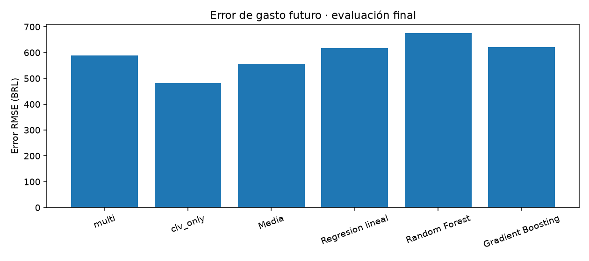
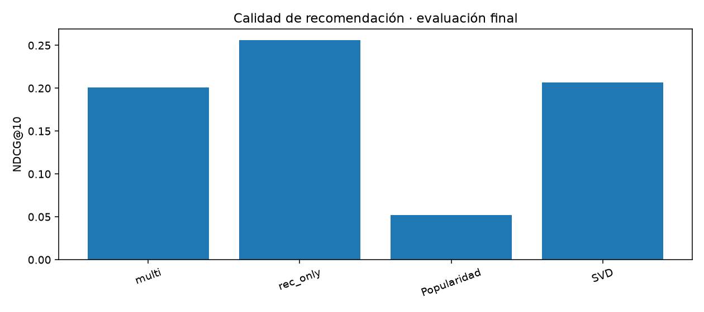

# Cliente 360 · Memoria de resultados

## Resumen y procedencia

Herramienta académica para estimar gasto a tres meses, recomendar productos y segmentar clientes a partir de una representación compartida. El escenario de esta memoria es **semisintético**. No se presenta como evidencia real de comportamiento de Olist ni de eficacia publicitaria.

Motor registrado en los pesos: **torch**. Dispositivo registrado: **cuda**. La configuración instalada no cambia la procedencia de los pesos. Esta memoria se construye con los informes guardados; deben corresponder a los mismos pesos y a la misma cohorte.

## Datos y protocolo

Se conservan 99,441 pedidos originales y se añaden 30,936 artificiales. La cohorte tiene 2,500 personas y el catálogo reducido 300 productos. Las variables latentes del generador no son entradas del modelo.

Train: corte 01/10/2017 y etiquetas hasta 01/01/2018. Validación: corte 01/01/2018 y etiquetas hasta 01/04/2018. Test: corte 01/04/2018 y etiquetas hasta 01/07/2018. Las entradas son anteriores a cada corte. Las etiquetas tienen inicio incluido y final excluido. Las mismas personas aparecen en distintos cortes; no es evaluación inductiva de clientes nuevos.

## Arquitectura

Una representación tanh combina embedding de cliente y proyección de variables históricas. La representación de producto combina ID, categoría y atributos físicos. Una cabeza estima gasto y otra calcula afinidades de producto. La pérdida combina MSE y BCE con negative sampling. La segmentación es posterior: K-Means sobre los embeddings, no una tercera cabeza supervisada.

El backend PyTorch permite auto/CPU/CUDA y mueve parámetros y tensores al dispositivo. La validación y el runtime siguen en NumPy. La configuración principal y su ponderación se registran en artifacts; la exploración OAT está en reports. No se afirma que la configuración sea un óptimo global ni que CUDA se haya ejecutado por el mero hecho de estar configurado.

## Evaluación de gasto

| model             |      MAE |     RMSE |   Spearman |   lift_top10 |
|:------------------|---------:|---------:|-----------:|-------------:|
| multi             | 432.9544 | 588.5739 |     0.4951 |       3.5189 |
| clv_only          | 325.6923 | 481.6110 |     0.5137 |       3.6328 |
| Media             | 391.9299 | 557.0059 |     0.0000 |       1.1349 |
| Regresion lineal  | 481.5979 | 616.9403 |     0.5104 |       3.7373 |
| Random Forest     | 468.7694 | 675.5018 |     0.5185 |       3.6178 |
| Gradient Boosting | 413.4185 | 622.0070 |     0.5179 |       3.5402 |

En esta tabla, el menor RMSE corresponde a **clv_only** (481.61 BRL). La red conjunta registra 588.57 BRL. No se concluye superioridad universal del aprendizaje conjunto. MAE y RMSE miden error monetario; Spearman y lift describen ordenación y concentración de gasto, no efecto causal de publicidad.

## Evaluación de recomendación

| model       |   Precision@10 |   Recall@10 |   NDCG@10 |   coverage |   eligible_users |
|:------------|---------------:|------------:|----------:|-----------:|-----------------:|
| multi       |         0.0853 |      0.2888 |    0.2011 |     0.7467 |             1569 |
| rec_only    |         0.1136 |      0.3796 |    0.2561 |     0.4233 |             1569 |
| Popularidad |         0.0247 |      0.0835 |    0.0522 |     0.0333 |             1569 |
| SVD         |         0.0951 |      0.2922 |    0.2067 |     0.5100 |             1569 |

El mayor NDCG@10 de esta tabla corresponde a **rec_only** (0.2561). El ranking considera el catálogo reducido completo y permite recompra de productos. Solo entran clientes con compras relevantes futuras; el denominador aparece en la tabla. Los scores no son probabilidades calibradas.

## Segmentos y acciones propuestas

| name                          |   customers |   frequency |   recency |   clv_pred | preferred_categories                                                                 | action                                                                            | channel                            | kpi                                       |
|:------------------------------|------------:|------------:|----------:|-----------:|:-------------------------------------------------------------------------------------|:----------------------------------------------------------------------------------|:-----------------------------------|:------------------------------------------|
| Reactivación · G1             |         211 |       10.72 |     74.53 |     523.55 | Informática y accesorios (79%); Deporte y ocio (2%); Belleza y cuidado personal (2%) | Probar un recordatorio de novedades y preferencias antes de ofrecer un incentivo. | Email con permiso de contacto      | Recompra a 90 días y bajas de suscripción |
| Reactivación · G2             |         807 |        5.90 |    127.20 |     314.07 | Muebles y decoración (36%); Deporte y ocio (16%); Herramientas y jardín (12%)        | Probar un recordatorio de novedades y preferencias antes de ofrecer un incentivo. | Email con permiso de contacto      | Recompra a 90 días y bajas de suscripción |
| Fidelización prioritaria · G3 |         809 |       18.30 |     34.05 |    1140.86 | Belleza y cuidado personal (16%); Deporte y ocio (14%); Muebles y decoración (14%)   | Probar una selección de productos complementarios, sin descuento generalizado.    | Email personalizado o área privada | Recompra a 90 días y margen por pedido    |
| Reactivación · G4             |         278 |        9.78 |     81.50 |     494.04 | Hogar y textiles (78%); Artículos originales (3%); Muebles y decoración (2%)         | Probar un recordatorio de novedades y preferencias antes de ofrecer un incentivo. | Email con permiso de contacto      | Recompra a 90 días y bajas de suscripción |
| Reactivación · G5             |         196 |       10.18 |     76.83 |     512.40 | Artículos para el hogar (79%); Informática y accesorios (2%); Juguetes (2%)          | Probar un recordatorio de novedades y preferencias antes de ofrecer un incentivo. | Email con permiso de contacto      | Recompra a 90 días y bajas de suscripción |
| Reactivación · G6             |         199 |        9.46 |     79.13 |     429.05 | Telefonía (79%); Hogar y textiles (3%); Artículos originales (2%)                    | Probar un recordatorio de novedades y preferencias antes de ofrecer un incentivo. | Email con permiso de contacto      | Recompra a 90 días y bajas de suscripción |

Las categorías preferidas se calculan con artículos comprados antes del corte. Los nombres comerciales se asignan mediante reglas descriptivas de gasto y recencia; no son etiquetas entrenadas de fidelidad o abandono. Las acciones y canales son propuestas para contrastar, no eficacia demostrada. Silueta y estabilidad están en los informes de segmentación; no prueban por sí solas utilidad comercial.

## Aplicación a marketing digital

El panel permite consultar clientes, revisar grupos, proponer personalización y construir una audiencia histórica descargable. El objetivo de campaña se guarda como contexto; el ranking de audiencia se basa en gasto previsto y filtros del usuario, no en una estimación de efecto de tratamiento.

No existen datos de emails, consentimiento, anuncios, clics o campañas ejecutadas. El coste de contacto es un supuesto introducido por el usuario. El gasto previsto no es ingreso atribuible a publicidad. La comparación top CLV frente a azar es retrospectiva, no una estimación causal ni un ROI.

## Discusión y límites

La ampliación incorpora relaciones por diseño; aprenderlas no valida esos supuestos en el mundo real. La muestra original tiene muy pocas compras relevantes en el catálogo reducido, por lo que no permite una conclusión general sobre todo Olist. El modelo rechaza clientes desconocidos en lugar de inventar embeddings.

La variante por categorías agrega salidas de producto; no es una red independiente. La recompra usa clasificadores de referencia; no una cabeza adicional multi-tarea. Los estratos de historial escaso no equivalen a clientes o productos completamente nuevos. La construcción Docker y la ejecución CUDA requieren comprobación en el equipo destino.

## Documentación complementaria

- [Metodología](metodologia.md).
- [Experimentos adicionales v2](anexo_v2.md).
- [Cobertura frente a la propuesta](cobertura.md).
- [Guía de marketing](guia_marketing.md).

La memoria se genera con los resultados actuales; antes de presentar, revisar interpretación, correspondencia entre pesos e informes y evidencia de las pruebas realizadas. No se incluye un PowerPoint terminado ni se garantiza una calificación.
